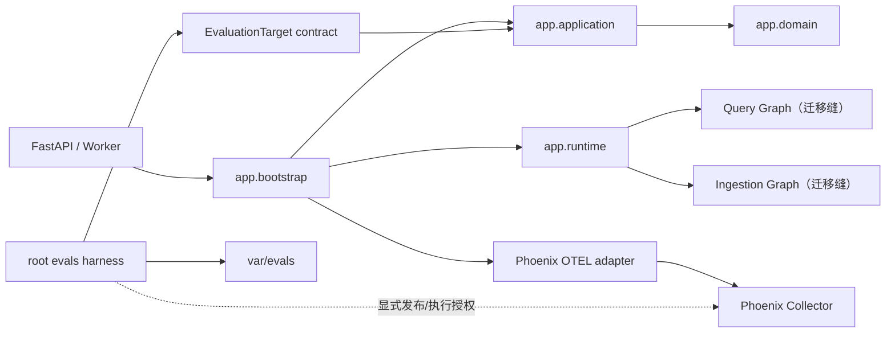

# 模块化单体与 Phoenix 评测架构

## 结论

本轮选择“模块化单体 + Phoenix 平台”，不把业务拆成微服务。业务事实仍由现有
SQL/对象存储/向量库持有；Phoenix 只接收默认关闭、显式脱敏的 OpenTelemetry Trace，
并作为 Dataset/Experiment 的可选协作界面。现有 HTTP 启动命令、数据库模型和
持久任务契约保持不变。

## 目录功能表

| 物理目录 | 状态 | 唯一职责 |
| --- | --- | --- |
| `app/domain/` | 保留 | 领域实体、值对象、状态机与纯策略；禁止依赖外层实现。 |
| `app/application/` | 收敛中 | 用例、Port/DTO 与公开 `EvaluationTarget` 契约；现有具体基础设施导入由 ratchet 管理。 |
| `app/bootstrap/` | 新增 | API/Worker 的组合根与外层适配器生命周期。 |
| `app/config/` | 新增 | 新架构强类型配置；当前承载 Phoenix 配置。 |
| `app/foundation/` | 新增 | 无业务、无基础设施依赖的最小复用工具。 |
| `app/runtime/` | 新增 | LangGraph 编译、缓存与运行时访问入口。 |
| `app/infrastructure/evaluation/` | 新增 | 把生产查询能力投影为稳定评测 Observation 的防腐适配器。 |
| `app/infrastructure/observability/` | 新增 | Phoenix/OpenTelemetry exporter 生命周期适配器。 |
| `app/infra/` | 迁移中 | 既有 SQL、Milvus、MinIO、模型与安全实现；继续作为外层适配器，禁止被新内层反向依赖。 |
| `app/api/` | 兼容入口 | 既有 FastAPI 路由和 schema；后续分批迁至 `app/adapters/inbound/http/`。 |
| `app/worker/` | 兼容入口 | 既有持久 Worker；已接入统一 bootstrap，后续迁至 inbound worker adapter。 |
| `app/process/` | 迁移中 | 既有 Graph/state/nodes；生产编译已移至 Runtime，后续迁入 `agent_system`。 |
| `app/rag/` | 迁移中 | 既有确定性 RAG 服务与 I/O 混合层；后续按 Agent service 与 infrastructure adapter 拆分。 |
| `app/security/` | 迁移中 | 既有身份、权限与 HTTP 安全；SQL 审计已下沉基础设施。 |
| `app/shared/` | 待退役 | 既有配置、客户端与工具集合；只允许债务减少，不允许新增依赖。 |
| `app/evaluation/` | 兼容门面 | 既有指标/报告与 Observation 兼容导出；执行资产和 harness 已迁至根 `evals/`。 |
| `evals/datasets/` | 新增 | 数据集 registry、版本与 SHA-256 内容寻址。 |
| `evals/scenarios/` | 新增 | 可执行场景 catalog 与数据集/config 绑定。 |
| `evals/configs/` | 新增 | 离线评测配置及只读 preflight 输入。 |
| `evals/contracts/` | 新增 | Observation 与 case-result 的版本化 JSON Schema。 |
| `evals/harness/` | 新增 | 无模型默认调用的目标执行、契约校验与 grader 编排。 |
| `evals/graders/` | 新增 | 确定性代码 grader；主观 judge 仍需独立校准和授权。 |
| `evals/baselines/` | 新增 | 批准基线 registry；历史大体积资产仍通过 legacy location 引用。 |
| `evals/platforms/` | 新增 | Phoenix Dataset upsert 与 Experiment 显式执行桥接。 |
| `tests/architecture/` | 新增 | AST 依赖边界、Tarjan SCC、导入期构造与迁移债务 ratchet。 |
| `tests/eval/` | 扩展 | 数据集、harness、registry、平台桥接与边界契约测试。 |
| `var/evals/` | 运行时 | 新评测报告、结果和 Trace 关联产物；被 Git 忽略。 |
| `docs/experiment/` | 新增 | 信源、选择、授权和验证记录；不保存秘密或大体积运行产物。 |

## Current → Target 映射

| Current | Target | 本轮状态 |
| --- | --- | --- |
| `app/api/http` | `app/adapters/inbound/http` + `app/bootstrap` | 已建立 bootstrap；路由物理迁移待逐批完成。 |
| `app/worker` | `app/adapters/inbound/worker` + `app/bootstrap` | 已统一观测生命周期；物理迁移待完成。 |
| `app/process/*/agent` | `app/agent_system/agents/*` + `app/runtime` | 编译与缓存已进入 Runtime；Graph 定义/节点仍是迁移缝。 |
| `app/rag/import_` | ingestion Agent services + infrastructure | 尚未物理迁移，受 legacy ratchet 约束。 |
| `app/rag/query` | query Agent services/domain policy + infrastructure | 生产评测调用已隔离；其余尚未物理迁移。 |
| `app/shared/config` | `app/config` | Phoenix 新配置已落目标目录；旧配置待逐项迁移。 |
| `app/shared/clients/model/runtime` | infrastructure/foundation/runtime | 尚未物理迁移，禁止新增消费者。 |
| `app/evaluation/observation` | `evals/harness` + `app/infrastructure/evaluation` | 已完成，旧文件仅保留兼容导出。 |
| `output/evaluation` | `var/evals` | 新写入已切换；旧持久路径仍可校验读取。 |
| `docs/evaluation-baselines` | `evals/baselines` + 外部制品存储 | registry 已建立；2.7GB 历史资产未做破坏性移动。 |

## 可执行边界与迁移债务

- 导入图 SCC：`2 → 0`。
- Application 已知外向边：79 条，必须是未来提交的上限而非目标值。
- Legacy Python 模块：207 个，只允许递减。
- Runtime 到旧 Graph 的迁移边：2 条，只允许 `get_query_graph` 与
  `get_ingestion_graph` 使用。
- bootstrap 外导入期框架构造：3 处（两个 FastAPI app 与 ingestion
  `StateGraph`），只允许递减。
- 新 `domain/config/foundation/evals/infrastructure/runtime` 边界使用严格规则；旧代码
  使用精确 baseline，不能通过新增 skip/xfail 扩大债务。

## Phoenix 安全与运行约束

- `PHOENIX_ENABLED=False` 为默认值；禁用时不会导入 SDK 或连接 collector。
- `PHOENIX_API_KEY` 只从环境读取，`SecretStr` 与生命周期回执均不回显原值。
- 自动 instrumentor 初始化时强制隐藏输入、输出、Prompt、工具参数、图片和 embedding
  vector；初始化完成后恢复调用进程原环境。
- exporter 缺失、配置错误、初始化失败和 shutdown 失败全部 fail-open，不改变业务结果。
- Dataset 发布和 Experiment 执行是显式外部写；本轮没有调用。`run_experiment` 还要求
  `execution_authorized=True`，避免预检意外触发模型或平台写入。
- 正式评测结果写入 `var/evals`；批准基线只通过 `evals/baselines/registry.json` 晋升。

## 回滚

1. 设置 `PHOENIX_ENABLED=False` 可立即关闭所有 Phoenix 导出，无需改变业务部署。
2. API 与 Worker 启动命令未改变。
3. 新报告写入 `var/evals`；数据库中已有 `output/evaluation` 路径仍可读取和校验。
4. `app.runtime.graphs.reset_graph_registry()` 仅用于测试/受控重装配，不用于生产热切换。

## 官方依据

- [Phoenix OpenTelemetry setup](https://www.arize.com/docs/phoenix/tracing/how-to-tracing/setup-tracing/setup-using-phoenix-otel)
- [Phoenix LangChain/LangGraph tracing](https://arize.com/docs/phoenix/integrations/python/langchain/langchain-tracing)
- [Phoenix span attribute masking](https://arize.com/docs/phoenix/tracing/how-to-tracing/advanced/masking-span-attributes)
- [Phoenix Dataset client](https://arize.com/docs/phoenix/sdk-api-reference/python/arize-phoenix-client)
- [Phoenix Experiments](https://arize.com/docs/phoenix/datasets-and-experiments/how-to-experiments/run-experiments)

